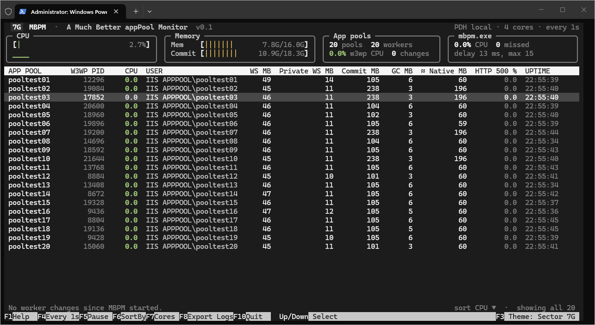
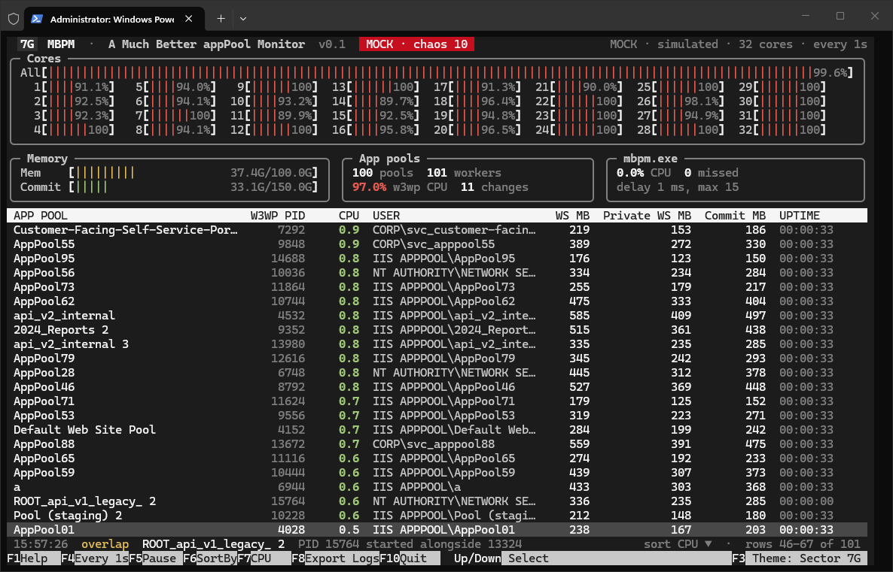

# MBPM  ·  A Much Better appPool Monitor

[](https://github.com/sector7g/MuchBetter/actions/workflows/build.yaml)
[](LICENSE)
[](https://claude.ai)

**Live CPU and memory per IIS application pool, htop-style, logged as you watch.**

Performance Monitor shows IIS worker processes as `w3wp`, `w3wp#1`, `w3wp#2`... with no hint of which app pool each serves. MBPM shows CPU and memory per app pool, live in the console, and logs the same data as a PerfMon log.

[Key benefits](#key-benefits) · [Read-only by design](#read-only-by-design) · [Background](#background) · [Quick start](#quick-start) · [Columns](#columns) · [Mock & chaos](#mock--chaos) · [Output](#output) · [Requirements](#requirements) · [Building](#building) · [License](#license)



## Key benefits

> **1. In effect, a custom performance counter without creating one.** Per-pool data is logged in PerfMon's format under its own counter sets, `Much Better App Pool(<pool>)` and `Much Better Machine`. Performance Monitor, `relog` and tools such as Splunk read it like any capture. Nothing is registered: no manifest, no `lodctr`, no install.
>
> **2. Right as workers come and go.** PIDs are joined to pools in the same sample as the figures, so renumbered `w3wp#n` instances are never misattributed. Recycled workers stay in their pool's column; web gardens are summed.
>
> **3. Read-only: it changes nothing on the server.** Apart from writing its own log files, MBPM only reads. One executable, nothing installed, no control over IIS. See [Read-only by design](#read-only-by-design).
>
> **4. Logged live, like a data collector set.** One row per second, flushed as it goes; a crash loses nothing already written.
>
> **5. Low overhead, and honest about it.** One counter query per sample. MBPM's own CPU, sample delay and missed samples are shown and logged.

## Read-only by design

**Apart from writing its log files, MBPM changes nothing on the system.** It reads performance counters, and WMI and process tokens for pool names and accounts. It installs nothing, registers no counters, changes no configuration, and provides no means to stop, start, kill, or recycle pools.

## Background

Which `w3wp.exe` serves which app pool? A [Microsoft support post](https://learn.microsoft.com/en-us/archive/blogs/dpaulexchange/tips-and-tricks-how-to-determine-which-w3wp-exe-process-belongs-to-which-application-pool) gives the two usual answers:

- **Task Manager:** add the Command Line column and read each `w3wp.exe`'s app pool there. Process Explorer and similar tools work the same way.
- **Performance Monitor:** collect `\Process(*)\ID Process` and `\W3SVC_W3WP(*)\*`, find the PID of the `w3wp#N` instance in question, then the `W3SVC_W3WP` instance carrying that PID, which is named after the pool.

That's fine for a live look, but it doesn't hold up after the fact:

- **Task Manager, Process Explorer and the like don't log.** Once the moment has passed, so has the answer.
- **Performance counters do log, but not the pool.** A `\Process` log identifies workers only as `w3wp#N`, an index Windows reassigns whenever a worker starts or exits ([duplicate instance names](https://learn.microsoft.com/en-ie/Windows/Win32/perfctrs/handling-duplicate-instance-names)), and a PID that's long gone by the time anyone reads the log. Matching them to pools is a manual job, instance by instance and time window by time window; the post itself warns to check the PID didn't change in between.
- **A data collector set only captures the workers present when it starts,** so workers started later aren't logged at all.

MBPM does that join live, every sample, and logs by pool name.

**History:** `bpm` ("**B**etter app**P**ool **M**onitor"), a PowerShell script that polled counters and WMI, skewed the numbers under load. `ebpm` ("**E**ven **B**etter..."), in C#, sampled with a data collector set and merged offline. `mbpm` ("Much Better.") reads PDH directly with IIS's pool names in the same sample, and logs per pool as it goes.

## Quick start

Download the latest `mbpm-<version>.zip` from [Releases](https://github.com/sector7g/MuchBetter/releases), unzip it on the IIS server, and run `mbpm.exe` from an elevated console. Nothing to install or build.

```text
mbpm                          monitor this machine (run elevated)
mbpm --mock                   simulated server, 64 cores, 100 pools
mbpm --mock cores=8,pools=12  smaller simulation (1-64 cores, 1-100 pools)
mbpm --mock chaos=5           ... with trouble: spikes, leaks, crashes, 500s, odd pool names (0-10)
mbpm -h                       all options
```

Keys: **F1** help, **F3** theme, **F4** interval, **F5** pause, **F6** sort, **F7** CPU / Cores, **F8** logs, **F10** quit.

## Columns

One row per worker process (`w3wp.exe`). Narrow windows drop USER first, then the .NET and HTTP 500 columns, then the memory columns.

| Column | Source | Notes |
| --- | --- | --- |
| APP POOL | `\W3SVC_W3WP(<PID>_<pool>)` instance names; WMI command line as a fallback | |
| W3WP PID | `\Process(w3wp*)\ID Process` | |
| CPU | `\Process\% Processor Time` ÷ logical processors | Share of the whole machine, as in Task Manager |
| USER | the worker's process token | e.g. `IIS APPPOOL\DefaultAppPool`; needs elevation |
| WS MB | `\Process\Working Set` | Task Manager: Working set (memory) |
| Private WS MB | `\Process\Working Set - Private` | Task Manager: Memory (private working set) |
| Commit MB | `\Process\Private Bytes` | Task Manager: Commit size |
| GC MB | `\.NET CLR Memory\# Bytes in all Heaps` | The .NET heap. Updated at each garbage collection |
| ≈ Native MB | Private Bytes − `\.NET CLR Memory\# Total committed Bytes` | An estimate: native allocations plus the CLR's own non-heap memory (JIT code, loader heaps, thread stacks) |
| HTTP 500 % | `\W3SVC_W3WP(<PID>_<pool>)\% 500 HTTP Response Sent` | Share of the worker's responses since the previous sample that were HTTP 500. Status 500 only: IIS has no counter for the whole 5xx range, and 503s from http.sys never reach the worker. 0 when there were no responses |
| UPTIME | `\Process\Elapsed Time` | Since this worker started |

The .NET columns show "-" for pools without .NET ("No Managed Code"); they're matched to workers by the CLR counters' own `Process ID`.

**Where ≈ Native MB is useful: the trend.** It isn't an exact measure of native memory, but it separates the two kinds of leak:

- **Native MB rising while GC MB stays flat** points to a native leak: COM components, native libraries, unmanaged buffers.
- **GC MB and Commit MB rising together** points to a managed leak: objects the application keeps referencing.

The export logs these columns per pool under `Much Better App Pool(<pool>)`, as "GC MB", "Native MB (approx)" and "HTTP 500 %". A web garden's workers are summed, except HTTP 500 %, where the highest worker's value is kept. In counter paths, `(` and `)` in a pool name are written `[` and `]`, and `/`, `\` and `#` as `_`, as Windows does for its own instance names.

## Mock & chaos

`--mock` runs MBPM against a simulated IIS server instead of real counters: the same screen, logging and export, with no IIS and no admin rights needed. Use it to try MBPM out, demo it, or test changes.

```text
mbpm --mock [cores=<n>][,pools=<n>][,chaos=<n>]
```

| Setting | Range | Default |
| --- | --- | --- |
| `cores` | 1–64 | 64 |
| `pools` | 1–100 | 100 |
| `chaos` | 0–10 | 0 |

At chaos 0 the server is calm: CPU and memory wander, and a worker is recycled now and then. Each step up adds more of what goes wrong on real servers:

| Trouble | What you'll see |
| --- | --- |
| CPU spikes | A worker jumps to 1–4 cores' worth of CPU for 5–30 s. |
| Memory leaks | A worker grows 5–40 MB/s, then crashes at 1.5–3 GB. Native leaks raise ≈ Native MB while GC MB stays flat; managed leaks raise GC MB with Commit MB. |
| Crashes | A worker vanishes with no replacement for 2–10 s, then a new one starts. |
| Recycles | Overlapped recycles, up to 31× as often at chaos 10. |
| HTTP 500 bursts | A worker returns 5–40 % 500s for 10–60 s. |
| Odd pool names | Every third pool gets a name that tests display and export: spaces, underscores, parentheses, non-ASCII and double-width characters, very long names. |



Mock sessions can't pass for real data: the title shows a red **MOCK** badge (with the chaos level, e.g. **MOCK · chaos 10**), the logs go to a `MOCK` folder, and the export's counter paths start with `\\MOCK\`.

## Output

Each run writes `%LOCALAPPDATA%\Sector 7G\mbpm\<machine>\<yyyyMMdd-HHmmss>\`:

| File | Contents |
| --- | --- |
| `mbpm_export_perfmon.csv` | Per-pool data in PerfMon's CSV log format (open via View Log Data, or `relog` to `.blg`). |
| `mbpm_export_cpu.csv` | Plain CSV for Excel: UTC and local timestamps, then CPU per pool. |
| `export_info.txt` | Source and how each column is computed. |
| `events.csv` | Worker changes. |

## Requirements

Windows with IIS, .NET Framework 4.8, a VT-capable console (Windows 10+; Windows Terminal recommended). Run elevated on the IIS server; MBPM monitors only the machine it runs on.

### Without elevation

MBPM still runs, but some values belong to other accounts' processes and can't be read:

| What | Not elevated | Why |
| --- | --- | --- |
| USER | "-" | Reading a worker's account needs access to its process token. |
| GC MB, ≈ Native MB | "-" | The .NET counters only show your own processes unless elevated. |
| APP POOL, for workers IIS hasn't named yet | "(unknown)", with a "hidden from WMI: run elevated" status line | The WMI fallback can't read other accounts' command lines. |

Expected to work either way, since they come from ordinary performance counters: CPU, WS MB, Private WS MB, Commit MB, UPTIME, HTTP 500 %, pool names from IIS's `W3SVC_W3WP` counters, the cards and the log files. The log has blank cells wherever the screen shows "-".

**Why .NET Framework 4.8:** it ships with Windows and Windows Server, so the tool is a small executable you copy and run, with nothing to install. PDH, WMI and the console APIs are all available. The cost is C# 7.3, which is enough here.

## Building

No need to build: precompiled versions are on the [Releases](https://github.com/sector7g/MuchBetter/releases) page. To build it yourself, use Visual Studio 2022 or later (Community edition is enough), or the free Build Tools for Visual Studio and `msbuild` without the IDE. See [BUILDING.md](BUILDING.md).

## License

[MIT](LICENSE). © 2017-2026 Sector 7G Consulting LLC.
